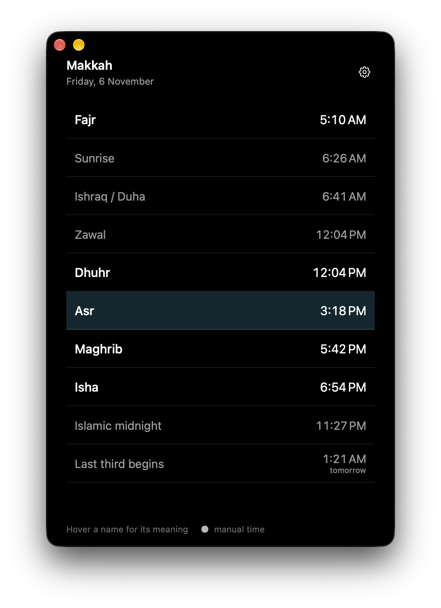

# Awqat

A minimal, native macOS prayer-times app for Hanbali fiqh with direct salah-time editing for matching the local masjid.



## What it shows

- Fajr, Dhuhr, Asr, Maghrib, and Isha
- Sunrise
- Ishraq / Duha
- Zawal
- Islamic midnight
- The beginning of the last third of the night

Hover any name to see a short explanation. The five salah rows are visually primary; the other Islamic day/night markers are secondary.

## Edit salah times to match your masjid

Open **Settings → Salah times**. Each salah has three modes:

- **Auto** — calculated by Adhan (default).
- **Today** — exact time for the current location date only; expires at midnight.
- **Daily** — exact fixed clock time repeated every day.

Type the time exactly as your masjid displays it. The calculated time is shown underneath for comparison. Use **Reset all to calculated** to return to Auto.

Notes:

- Manual Fajr and Maghrib also shift Islamic midnight and the last third.
- Manual Dhuhr does not move Zawal; Zawal remains the calculated solar meridian.
- **Daily** repeats a fixed clock time and does not follow seasonal changes or DST. Use **Today** for one-off corrections.
- A small dot next to a time in the main window means that salah is manually set.

## Calculation defaults

- Fajr angle: **18°**
- Isha: **17°** angle (a practical approximation of red-twilight disappearance)
- Asr: **Hanbali** — shadow equals object height
- High latitude: automatic (Adhan's recommended rule)
- Rounding: nearest minute
- Presets: Hanbali (default), Umm al-Qura (18.5° / 90 minutes), Custom

Hanbali Isha begins at the disappearance of red twilight. Adhan exposes a custom angle or a minute interval for Isha, so the default uses 17° as an approximation. This is configurable, and the direct salah-time editor exists precisely so the app can match your local masjid. Times are astronomical estimates, not a fatwa. Confirm with your local people of knowledge.

## Menu bar

Enable **Settings → Menu bar → Show in menu bar**.

- **All five** (default): compact title with all five salah times, e.g. `F 5:10a D 12:04p A 3:18p M 5:42p I 6:54p`.
- **Next prayer**: a narrower title such as `Asr 3:18 PM`.

Clicking the item shows exactly the five salah times, plus Open, Settings, and Quit. Sunrise, Zawal, midnight, and the last third are never shown in the menu bar.

## Privacy and locality

- No network access.
- No CoreLocation and no location detection.
- No analytics, accounts, ads, or telemetry.
- Settings are stored only in the app's local `UserDefaults`.
- Calculations happen locally through the vendored Adhan source.

The only manual location input is latitude, longitude, an optional label, and a time zone.

## Build

Requirements:

- macOS 14 or later
- Xcode Command Line Tools (full Xcode is not required)
- arm64 Mac

From the project directory:

```sh
./scripts/check.sh
./scripts/build-app.sh
open dist/Awqat.app
```

The build compiles Swift + AppKit and the vendored Adhan 1.5.0 sources directly with `swiftc`. There is no package resolution, web runtime, or Xcode project required.

The output is `dist/Awqat.app`, ad-hoc signed for local use. If Gatekeeper quarantines a copy, right-click the app and choose Open. The app is not notarized for distribution.

## Using the app

1. Launch Awqat.
2. Click the gear or the **Set Location** button.
3. Enter latitude, longitude, an optional label, and a time zone. You can use **Use system** for the current macOS time zone.
4. Save.
5. To align with your masjid, open Settings → Salah times and edit any time.

You can drag `dist/Awqat.app` to `/Applications`.

## Layout

```
Sources/Core/        Calculation, settings, overrides, next-prayer logic
Sources/App/         AppKit UI, custom controls, settings, menu bar
Vendor/Adhan/        Adhan Swift 1.5.0 sources + MIT license
Resources/           Info.plist and app icon
Tests/               Deterministic checks and UI probes
scripts/             Build, check, and icon scripts
dist/Awqat.app       Built app
```

## Tests

```sh
./scripts/check.sh
```

The checks cover the Umm al-Qura fixture, Hanbali Asr, Auto/Today/Daily overrides, after-midnight Isha, night markers following manual Fajr/Maghrib, Zawal stability, next-prayer rollover, settings validation, time parsing, and a polar-location fallback.

## License

App code is provided as-is for personal use. Adhan Swift is MIT licensed; see [THIRD_PARTY_NOTICES.md](THIRD_PARTY_NOTICES.md).
